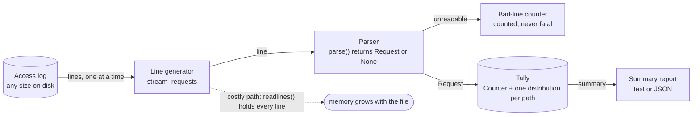

# Architecture: logsum, a streaming log summarizer

`logsum` reads an access log one line at a time and keeps only a running tally, so its memory depends on the number of distinct paths and on the latency store it uses, not on the size of the file. This document names the components, shows the data flow, records the decisions and says what a production tool would add.

## Components and what each owns

The names follow the lesson's diagram, "logsum streams a log one line at a time".

| Lesson's component | Code | Layer | Owns |
| --- | --- | --- | --- |
| Access log (store) | `FileLineSource` in `infrastructure/log_files.py` | infrastructure | opening the file (plain or `.gz`), decoding it, closing it, turning I/O failures into `UnreadableLogFileError` |
| Line generator (function) | `stream_requests` in `application/summarize.py` | application | yielding one parsed `Request` per readable line, holding one line at a time |
| Parser (service) | `parse` and `Request` in `domain/request.py` | domain | what a good line is: five fields, a time-zone timestamp, a status 100-599, whole milliseconds |
| Bad-line counter (note) | `BadLineCounter` in `application/summarize.py` | application | the count of lines skipped, kept in an object because a generator's `return` value is invisible to a `for` loop |
| Tally (store) | `LogTally`, `ExactLatencies`, `HistogramLatencies` in `domain/` | domain | the status `Counter`, one latency distribution per path, the ranking of paths |
| Summary report (document) | `Summary` in `domain/tally.py`, `render_text` and `render_json` in `interfaces/render.py` | domain, interfaces | the numbers, and how they are printed |
| The logsum process | `SummarizeLog` (use case) and `main` in `interfaces/cli.py` (wiring, exit codes) | application, interfaces | one run: open, stream, tally, time it, measure memory, report |

Around them: `Settings` (environment, validated), `LogfmtFormatter` (structured logging), `SystemClock` and `TracemallocMeter` (the clock and the memory meter, injected through ports), `sample_log.py` (the lesson's log generator, with a seeded random generator passed in).

## Pattern: ports and adapters with a functional core

The core is a few pure functions and value objects (`parse`, `p95`, `LogTally`); everything that touches the world (the file, the clock, the memory meter) sits behind a port in `application/ports.py` and is implemented in `infrastructure/`. It fits a small tool because the interesting logic (what a bad line is, how a percentile is taken) can be tested without files, and the parts that do touch files (gzip, truncated input, a closed pipe) are tested once, in the adapter, against real files. Four layers as folders, with the dependency rule enforced by import-linter, make the rule visible in the tree and break the build when someone breaks it.

## Data flow

### One run, step by step (`logsum data/sample.log --stats`)

1. `main` reads the environment into `Settings`, parses the flags (flags win), configures logging on standard error and builds `SummarizeLog` with a `FileLineSource`, a `SystemClock`, a distribution factory and, because of `--stats`, a `TracemallocMeter`.
2. `SummarizeLog.run` starts the meter, notes the time and opens the file through the port. The context manager guarantees it is closed, also when reading fails.
3. `stream_requests` pulls one line from the file iterator (the rest stays on disk) and strips its line ending.
4. `parse` splits the line and checks it. It returns a `Request` (an immutable record with no per-instance dictionary) or `None`.
5. For `None`, the generator adds one to the `BadLineCounter` and moves on. For a `Request`, it yields it.
6. `LogTally.add` counts the status in a `Counter` and files the latency in the distribution of the request's path, creating it on first sight.
7. At the end of the file the loop ends, the elapsed time is read and the meter stopped; the bad-line count is handed to the tally.
8. `LogTally.summary` takes the 95th percentile of each path (exclusive method, capped at the slowest request), sorts by percentile descending with the path name as the tie-break, and keeps the top N.
9. `render_text` or `render_json` formats the `Summary`; `main` prints it to standard output and returns exit code 0.

## Decisions and trade-offs

| Decision | Why | Cost |
| --- | --- | --- |
| Stream with a generator and a `with open(...)` | memory independent of file size; the file closes on any error | one pass only: a second question needs a second run |
| `parse` returns `None` instead of raising | a bad line is routine in a large log; the type checker forces the caller to handle it | the caller must check, and the reason a line was bad is not reported (a `ParseResult` with a reason would add that) |
| Count bad lines in an object passed to the generator | a generator's return value cannot be read from a `for` loop | a small mutable object, the only one in the design, owned by the use case |
| One distribution per path | the ten slowest paths are compared with each other; a percentile over all latencies mixed says nothing about any one path | state grows with the number of distinct paths |
| `ExactLatencies` keeps a list per path (default) | exact percentile in four lines | memory grows with requests per path: a hot path with tens of millions of requests holds tens of millions of integers. `--estimator histogram` is the fix, at the accuracy cost stated in [ADR 0004](docs/adr/0004-fixed-size-histogram-estimator.md) |
| Percentile by `statistics.quantiles` (exclusive), capped at the maximum | the lesson's definition (19.95 for 1 to 20); the cap keeps a handful of requests from reporting a latency nobody saw | differs from the bare library call only for small samples ([ADR 0003](docs/adr/0003-percentile-definition.md)) |
| Replace undecodable bytes instead of failing | one bad byte sequence is one bad line, like any other | the original bytes are not kept |
| `tracemalloc` only with `--stats` | it measures what should stay flat (Python allocations) | tracing makes the run about 2.5 times slower, so it is opt-in |
| No runtime dependencies | the tool installs anywhere Python does; nothing to audit at run time | `argparse` instead of a nicer command-line library |
| `uv` with `uv.lock`, hatchling as the build backend | the lesson's choice; the lock file makes "installs the same way on every machine" true | needs `uv` for the documented commands (plain `pip install .` also works) |

## Failure modes the lesson teaches, and how the code shows them

| Failure | What happens | How to see it |
| --- | --- | --- |
| Reading the whole file into a list | memory grows with the file | `make demo-memory`: streaming peaks at 0.1 MB on a tenth of the log and on all of it; `readlines()` peaks at 4.6 MB and 44.4 MB |
| One bad line stops the run | an exception from a parser would end a 500,000-line job at line 12 | `make run` prints `bad lines: 300` and still summarizes the other 499,700; `tests/unit/application/test_summarize.py` |
| A percentile over mixed paths, or a mean | hides the slow path | `tests/unit/domain/test_tally.py::test_each_path_keeps_its_own_distribution` |
| The parser accepts a wrong unit | a latency of `87s` is read as `87ms` | `make mutation-check` changes the accepted suffix and the tests fail (15 of 104 unit tests) |
| A development environment hides a packaging mistake | the wheel works only where the source tree is importable | `make install-check` installs only the wheel into an empty environment and runs it from another directory |
| A hot path with millions of requests | the exact latency list grows without bound | `--estimator histogram`, fixed 8 KB per path at the defaults |

## Limits of the teaching build against production

- One file, one pass. A production tool would tail a log, handle rotation, and flush summaries on an interval.
- Path cardinality is unbounded: `/orders/1234` and `/orders/1235` are two paths. A production tool would normalize paths (`/orders/{id}`) and cap the number of tracked paths.
- One line format. Real servers write combined-format or JSON lines; each would be another parser behind the same `Request`.
- Percentiles over a whole file say nothing about time; a production tool would bucket by minute and keep a mergeable sketch (t-digest, HDR histogram) per bucket.
- Single process. A multi-gigabyte log could be split by byte range and the tallies merged; `LogTally` has no merge today.

## How to extend it

- A second parser: add `parse_combined(line)` in `domain/`, a `--format` flag in `interfaces/cli.py`, and the same use case.
- A merge operation on `LogTally` and `LatencyDistribution` (counts add; histograms add bucket by bucket), then a process pool over byte ranges.
- A rejected-lines file: give `stream_requests` a sink port for bad lines, so they can be inspected without failing the run.
- A reason for each bad line: have `parse` return a small result type and let the tally count reasons.
